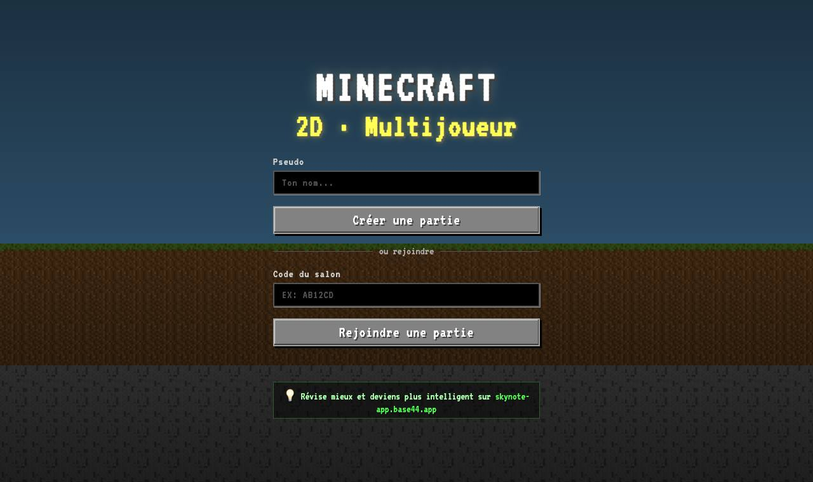
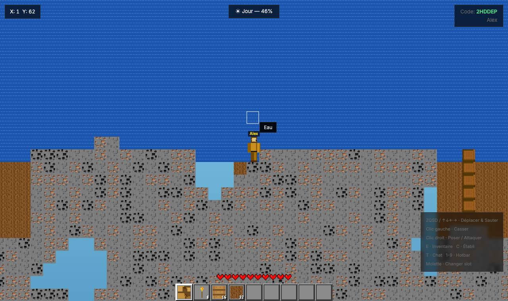
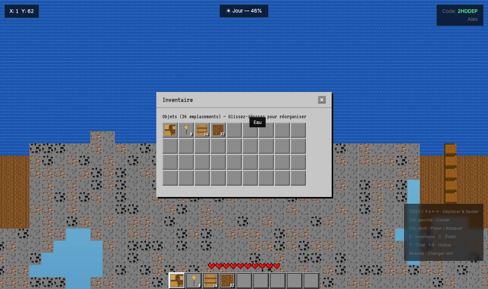

# Minecraft 2D (Craft2D)

Un **Minecraft en 2D, multijoueur, dans le navigateur**. On crée une partie, on partage son code à 6 caractères, et on mine, construit et fabrique à plusieurs dans le même monde.

| Menu | Le monde | Inventaire |
|---|---|---|
|  |  |  |

## Le jeu

- **Monde généré** : chunks de 16 blocs de large, 128 de haut, avec 35 types de blocs (minerais, bois, verre, TNT, laine…).
- **Contrôles** :

  | Touche | Action |
  |---|---|
  | ZQSD ou flèches | se déplacer et sauter |
  | clic gauche | casser |
  | clic droit | poser ou attaquer |
  | E | inventaire |
  | C | établi |
  | T | chat |
  | 1 à 9 ou molette | barre d'objets |

- **Survie** : cœurs, cycle jour/nuit, monstres, réapparition.
- **Multijoueur** : jusqu'à 100 salons, chat, et anti-spam (limite de vitesse des actions).

## Lancer

```bash
npm install
npm start
```

Ouvre ensuite http://localhost:3000 (ou partage l'adresse avec tes amis sur le même réseau).

## Technique

- **`server.js`** : un serveur Node.js qui sert la page et gère tout le jeu en **WebSocket** (`ws`). Il s'occupe des salons, de la génération du terrain par bruit, des blocs cassés et posés, des monstres et du chat. Il valide les actions pour éviter la triche.
- **`index.html`** : tout le client dans un seul fichier, avec le rendu Canvas 2D, les textures dessinées par le code, l'inventaire, l'établi et le HUD.

## État actuel

- **Le serveur ne démarre pas** : les 4 dernières lignes de `server.js` sont collées en double (`.trim() || 'Player'; }` puis `server.listen(...)`). Node s'arrête donc avec une `SyntaxError`. Il suffit de supprimer ce doublon à la fin du fichier.
- **Ciel plein d'eau** : une fois le doublon retiré, le jeu tourne, mais le ciel au-dessus du terrain est rempli de blocs d'eau (voir la capture).
